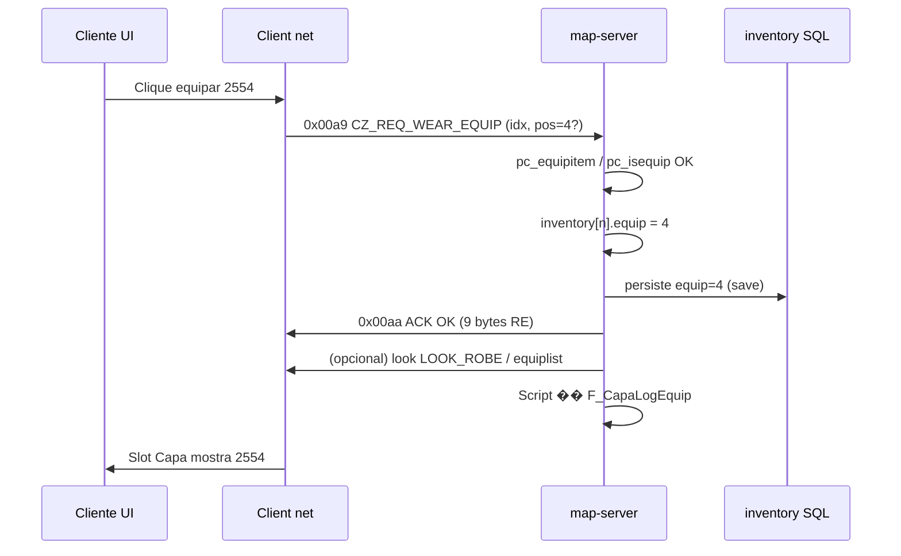

# Mapa: equip/unequip da capa (item 2554)

> **Regras operacionais (PROIBIDO / checklist):** [`regras/capa-equip.md`](../regras/capa-equip.md) — ler antes de mexer. Índice: [`regras/README.md`](../regras/README.md).

**Escopo:** BrasaRO Ep 13.2 + Docker rAthena Pre-RE `PACKETVER 20100730` (cliente `2010-07-30aRagexeRE`).  
**Item:** `2554` — Pele do Guardião / garment (`EQP_GARMENT` = bit **4**).  
**Objetivo deste arquivo:** mapa técnico (pacotes, funções, diagramas). Regras curtas ficam em `regras/`.

Última atualização do mapa: 2026-11-20.

**Status:** causa raiz (ACK `0x00aa` 7 vs 9 bytes sem `PACKETVER_RE`) corrigida e deployada; aguardando reteste in-game (equipar / desequipar / reequipar 2554).

---

## Sintoma observado

1. Cliente mostra capa ��solta�� / ?cone estranho / mensagem **��foi retirado��** e/ou **��Voc? n?o pode equipar este item��**.
2. No servidor / SQL o item frequentemente continua com `inventory.equip = 4` (equipado de verdade).
3. Relog ?s vezes ��conserta�� a UI (cliente reidrata pelo invent?rio), o que mascara desync cliente��servidor.

Conclus?o operacional: **servidor e cliente discordam do estado do slot garment**, ou o cliente **interpreta mal o ACK de equip** mesmo quando o server aceitou.

---

## Fluxo completo (cliente �� servidor �� cliente)

### 1) Clique equip / unequip no cliente

| A??o UI | O que o client faz |
|--------|---------------------|
| Equipar item do invent?rio (duplo clique / arrastar p/ slot capa) | Envia **CZ_REQ_WEAR_EQUIP** `0x00a9`: `<index>.W` `<position>.W` |
| Desequipar do slot Equipamento | Envia **CZ_REQ_TAKEOFF_EQUIP** `0x00ab`: `<index>.W` |

- `index` no wire = ?ndice **client** (server usa `server_index = client_index - 2` no parse).
- `position` = m?scara de slot pedida pelo client (garment esperado = `0x0004`).

Handlers no map-server (rAthena):

- `clif_parse_EquipItem` �� `pc_equipitem(sd, index, p->position)`
- `clif_parse_UnequipItem` �� `pc_unequipitem(sd, index, 1)`

Fonte de refer?ncia no build: `src/map/clif.cpp` (clonado no Docker; patches em `server/patches/`).

### 2) Pacotes relevantes (PACKETVER 20100730 + RagexeRE)

| Dire??o | Opcode | Nome | Conte?do relevante |
|---------|--------|------|--------------------|
| C��S | `0x00a9` | CZ_REQ_WEAR_EQUIP | index, position |
| S��C | `0x00aa` | ZC_REQ_WEAR_EQUIP_ACK | **cr?tico** ? ver tamanho abaixo |
| C��S | `0x00ab` | CZ_REQ_TAKEOFF_EQUIP | index |
| S��C | `0x00ac` | ZC_REQ_TAKEOFF_EQUIP_ACK | index, wearLocation, result |
| S��C | (lista inv) | inventory list / equiplist | cada item traz `equip` (bitmask); garment = `4` |
| S��C | look | `LOOK_ROBE` via `clif_changelook` | view visual da capa no personagem |

#### ACK de equip `0x00aa` ? ponto mais importante

Em `packets_struct.hpp` (rAthena):

| Build | Struct `PACKET_ZC_REQ_WEAR_EQUIP_ACK` | Tamanho t?pico |
|-------|----------------------------------------|----------------|
| **MAIN** (sem `PACKETVER_RE`) com date 20100730 | `type + index + wearLocation + result` | **7 bytes** |
| **RE** (`PACKETVER_RE`) e `PACKETVER_RE_NUM >= 20100629` | `type + index + wearLocation + wItemSpriteNumber + result` | **9 bytes** |

Cliente **2010-07-30aRagexeRE** espera o layout **RE (��20100629)** = **9 bytes**.  
Se o server mandar 7 bytes, o client l? o byte `result` no lugar errado �� UI falha (��n?o pode equipar��) **mesmo com** `inventory.equip=4` e Script/OnEquip rodando.

Confirma??o no build BrasaRO:

- `server/custom/defines_pre.hpp` for?a `#define PACKETVER_RE`
- `server/Dockerfile` copia esse header e aplica `clif_equipack_size_log` �� log `[CapaLog] EQUIPACK sizeof=��` (esperado **9**)

Fun??o: `clif_equipitemack()` em `clif.cpp` ? preenche `wearLocation`, opcionalmente `wItemSpriteNumber` (= `item->look` se `EQP_VISIBLE`), e `result` (`ITEM_EQUIP_ACK_OK` / fail).

### 3) Fun??es rAthena (ordem happy path ? equip)

```
clif_parse_EquipItem
  �� pc_equipitem(sd, n, req_pos)
       �� pc_isequip()                    // n?vel, job, class, identify, etc.
       �� [BrasaRO] se j? equipado: sync-only (ver patches)
       �� libera slots conflitantes via pc_unequipitem(..., 1|2|4)
       �� clif_equipitemack(OK, n, pos)
       �� inventory[n].equip = pos        // garment �� 4
       �� status/calc + look (LOOK_ROBE se aplic?vel)
       �� roda item Script (OnEquip)
            �� callfunc "F_CapaLogEquip"  // import item_db 2554
```

Unequip:

```
clif_parse_UnequipItem
  �� pc_unequipitem(sd, n, flag)
       �� limpa equip_index / inventory[n].equip = 0
       �� clif_unequipitemack(...)
       �� UnEquipScript �� callfunc "F_CapaLogUnequip"
```

### 4) Bit `inventory.equip` e slot garment

| Constante | Valor | Uso |
|-----------|-------|-----|
| `EQP_GARMENT` | `0x000004` (**4**) | bitmask no campo SQL/`items_inventory[].equip` |
| `EQI_GARMENT` | ?ndice no array `equip_index[]` | slot l?gico ��capa�� |

- Equipado: `equip = 4` **e** `equip_index[EQI_GARMENT] == n`.
- Invent?rio solto: `equip = 0`.
- **Ghost (defini??o usada no NPC log):** item 2554 no invent?rio com `bit != 0` mas `getequipid(EQI_GARMENT) != 2554`.

Tabela SQL: `inventory` (char DB) ? coluna `equip` / `nameid`.

### 5) `item_db` 2554

| Fonte | Caminho | Notas |
|-------|---------|--------|
| Base Pre-RE | `server/data/db/pre-re/item_db_equip.yml` | `Locations.Garment`, `EquipLevelMin: 1`, Jobs All **exceto** Novice/SuperNovice, **sem** View expl?cito no trecho padr?o |
| Override BrasaRO | `server/data/db/import/item_db.yml` | Jobs/Classes `All: true`; `Script`/`UnEquipScript` com `F_CapaLog*` |

Import atual (resumo):

- Location: Garment
- EquipLevelMin: 1
- Script: `callfunc "F_CapaLogEquip";` + bonuses oficiais
- UnEquipScript: `callfunc "F_CapaLogUnequip";`

### 6) Tabela `capa_equip_log` + NPC (LOG-ONLY)

Arquivo: `server/npc/custom/capa_equip_sync.txt`  
Carregado por: `server/npc/custom/episode_13_2_lock.conf` �� `npc: npc/custom/capa_equip_sync.txt`

| Pe?a | Comportamento atual |
|------|---------------------|
| `#CapaEquipSync` | NPC `-1` (invis?vel). **S? log** ? sem refresh, sem recriar item, sem unequip for?ado |
| `OnPCLoginEvent` / `Logout` | `F_CapaLog` |
| `@capalog` | grava estado manual + `dispbottom` |
| `F_CapaLogEquip` / `Unequip` | chamados pelo Script/UnEquipScript do item |

Colunas: `ts, account_id, char_id, char_name, event, slot_id, inv_bit, inv_idx, detail` (`cnt=�� ghost=0|1`).

### 7) Como a UI Equipamento decide ��slot capa�� vs invent?rio

O client **n?o** consulta SQL. Ele usa o estado em mem?ria alimentado por:

1. **Inventory / equipment list** no login e ap?s updates (`clif_inventorylist` / `clif_equiplist`).
2. **ACK** `0x00aa` / `0x00ac` ap?s cada clique.

Regra pr?tica do client 2010:

- Se o item no invent?rio local tem location garment **e** flag de equipada �� desenha no slot **Capa** da janela Equipamento.
- Se ACK de equip falha (ou ? lido como fail) �� item permanece / volta para lista de invent?rio e mostra msg de erro ? **mesmo que o server tenha setado `equip=4`**.
- Relog: client reconstr?i a partir da lista completa �� pode ��parecer ok�� se o server estava certo.

?cone / sprite do item v?m do GRF + tabelas `idnum2*` / `num2*` ? **n?o mexer** (ver se??o descartados).

---

## Diagramas Mermaid

### Happy path (equip)



### Fluxo bug (desync / ACK mismatch)

```mermaid
sequenceDiagram
  participant UI as Cliente UI
  participant CL as Client net
  participant MS as map-server
  participant DB as inventory SQL

  UI->>CL: Clique equipar 2554
  CL->>MS: 0x00a9
  MS->>MS: pc_equipitem OK
  MS->>MS: equip=4 + Script OK
  MS->>DB: equip=4
  Note over MS,CL: Se ACK 7 bytes (MAIN) ou result/pos errados
  MS->>CL: 0x00aa mal interpretado
  CL->>UI: "n?o pode equipar" / slot vazio
  Note over UI,DB: UI solta; SQL ainda equip=4 = GHOST visual
  UI->>CL: Tenta equipar de novo
  CL->>MS: 0x00a9 (j? equipado no server)
  MS->>CL: EQUIPSYNC ACK OK + equiplist (patch atual)
  Note over UI: Usu?rio ainda reportou falha visual / msgs ruins
```

Unequip bug espelhado: client mostra ��retirado��, server pode manter ou limpar bit de forma inconsistente com a UI �� pr?ximo equip vira ��n?o pode��.

---

## Pontos j? mexidos / descartados (N?O repetir)

| Tentativa | Status | Por qu? |
|-----------|--------|---------|
| Mudar ?cone/sprite/`resname` (`idnum2itemresnametable` / `num2itemresnametable`) | **PROIBIDO** | Piorou (?cone Und / spoof); revertido 2026-11-20 21:28 |
| `@refresh` / recreate login | **PROIBIDO** | Gambiarra, flicker |
| Force unequip + re-equip cycle (patch antigo / NPC) | **PROIBIDO** | UX horr?vel; flicker; mensagens de erro |
| NPC **Fix Capa** (`prt_fix_capa.txt`) | **Removido** | Arquivo agora `.off`; n?o carregar de novo como ��fix�� |
| Patch sync-only: se j? equipado �� `ACK_OK` + `inventorylist` + `equiplist` | **Deployado** (`pc_equip_desync.patch.sh`) | Usu?rio ainda v? ��foi retirado�� + ��n?o pode equipar�� ? trata sintoma, n?o causa |
| Patch `pc_capa_equip_refresh` (reenviar lists ap?s OK) | Existe em `patches/` mas **n?o** entra no Dockerfile atual | Redundante / ruidoso com sync-only |
| Logs `ShowInfo EQUIPREQ/UNEQUIPREQ`, SQL `capa_equip_log`, `@capalog` | **?teis** | Diagn?stico apenas ? **n?o s?o fix** |

### O que est? no Docker build agora (refer?ncia)

Arquivo: `server/Dockerfile`

1. `COPY custom/defines_pre.hpp` �� `#define PACKETVER_RE`
2. `patches/pc_equip_desync.patch.sh` (sync-only already-equipped)
3. `patches/pc_capa_equip_log.patch.sh` (`EQUIPREQ` / `UNEQUIPREQ`)
4. `patches/clif_equipack_size_log.patch.sh` (`EQUIPACK sizeof=`)
5. NPC log-only `capa_equip_sync.txt`

Registro tamb?m em: `ALTERACOES_CLIENTE.md` (se??es capa 2554 + PACKETVER_RE).

---

## Hip?teses restantes (priorizadas) ? onde o bug REAL pode estar

Ordem sugerida de investiga??o (**sem** ?cone / refresh / force unequip):

1. **ACK `0x00aa` size / `PACKETVER_RE` n?o efetivo no bin?rio rodando**  
   - Hip?tese documentada como causa raiz (22:10): build MAIN �� 7 bytes; RagexeRE espera 9.  
   - **Validar:** `docker logs` �� `[CapaLog] EQUIPACK sizeof=9`. Se for 7, rebuild obrigat?rio. Se j? ? 9 e o bug persiste, descer a lista.

2. **ACK OK no server, mas client ainda trata como fail**  
   - `result` / `wearLocation` / `wItemSpriteNumber` inconsistentes (ex.: pos 0 no ACK).  
   - Patch EQUIPSYNC manda `ACK_OK` com pos atual ? se o client j? ��desequipou�� localmente, listas sozinhas podem n?o bastar ou chegam numa ordem que o client ignora.

3. **Desync de estado ap?s unequip (ghost bit 4)**  
   - Server: `equip=4`, client: item na bag.  
   - Ou server: `equip=0`, client: ainda no slot.  
   - Confirmar com SQL + `capa_equip_log.ghost` + `EQUIPREQ cur_equip=`.

4. **Cliente ��cannot equip�� sem rejei??o server**  
   - Mensagem local (item n?o identified, janela errada, script client) **antes** ou **apesar** do ACK.  
   - Cruzar: se houver `EQUIPREQ` + `script_equip` / `equip=4` e UI falhou �� quase certo problema de **protocolo/UI**, n?o `pc_isequip`.

5. **Look / ViewId garment (`LOOK_ROBE`, `item->look`)**  
   - 2554 base **sem** `View:` no YAML Pre-RE �� `wItemSpriteNumber` tende a 0.  
   - Em geral OK para ACK; pode afetar s? visual do personagem, n?o a msg ��n?o pode equipar��. Prioridade menor que (1)?(4).

6. **Mapeamento position garment no CZ (client manda pos �� 4)**  
   - Patch desync j? tenta alinhar `req_pos`/`pos` quando a m?scara ? single-bit.  
   - Se logs mostrarem `req_pos` estranho + fail antes do sync, revisitar s? com evid?ncia de log.

7. **Outros PACKETVER side-effects de for?ar `PACKETVER_RE`**  
   - Outros packets podem mudar layout. S? investigar se (1) confirmou sizeof=9 e surgirem bugs novos fora da capa.

---

## Checklist de diagn?stico

### SQL

```sql
-- ?ltimos eventos da capa
SELECT id, ts, char_name, event, slot_id, inv_bit, inv_idx, detail
FROM capa_equip_log
ORDER BY id DESC
LIMIT 50;

-- Estado real do item no invent?rio do char
SELECT id, char_id, nameid, amount, equip, identify, refine, unique_id
FROM inventory
WHERE nameid = 2554
ORDER BY char_id, id;

-- Ghost cl?ssico: equip bit setado
SELECT id, char_id, nameid, equip
FROM inventory
WHERE nameid = 2554 AND equip <> 0;
```

### Docker / map-server

```text
docker logs ro132-rathena 2>&1 | findstr /I "CapaLog EQUIPREQ UNEQUIPREQ EQUIPSYNC EQUIPACK"
```

O que olhar:

| Log | Significado |
|-----|-------------|
| `EQUIPACK sizeof=9` | Layout RE OK |
| `EQUIPACK sizeof=7` | **ainda MAIN** ? causa raiz cl?ssica |
| `EQUIPREQ �� cur_equip=4` | Client pediu equip em item j? marcado no server |
| `EQUIPSYNC already-equipped` | Ramo sync-only disparou |
| `UNEQUIPREQ �� cur_equip=4��` + SQL `equip=0` | Unequip server OK |
| `CapaLog �� ghost=1` | Bit invent?rio �� slot EQI_GARMENT |

### In-game

- `@capalog` ? grava snapshot sem alterar itens.
- **N?o** usar `@refresh` como ��teste de fix��.

### Cliente (somente leitura)

- Confirmar EXE = build Ep 13.2 RagexeRE 20100730 (ver `ALTERACOES_CLIENTE.md` / NEMO).
- **N?o** adicionar `idnum2itemresnametable` / `num2itemresnametable` para 2554.

---

## ?ndice de arquivos reais (workspace)

| Papel | Caminho |
|-------|---------|
| Este mapa | `docs/MAPA_CAPA_EQUIP.md` |
| Hist?rico / proibi??es | `ALTERACOES_CLIENTE.md` |
| Config Ep 13.2 | `server/docs/CONFIG_EP132.md` |
| `PACKETVER_RE` | `server/custom/defines_pre.hpp` |
| Build Docker | `server/Dockerfile` |
| Patch sync-only | `server/patches/pc_equip_desync.patch.sh` |
| Patch log equip | `server/patches/pc_capa_equip_log.patch.sh` |
| Patch sizeof ACK | `server/patches/clif_equipack_size_log.patch.sh` |
| Patch refresh (n?o usado no Dockerfile) | `server/patches/pc_capa_equip_refresh.patch.sh` |
| NPC log-only | `server/npc/custom/capa_equip_sync.txt` |
| NPC Fix Capa (morto) | `server/npc/custom/prt_fix_capa.txt.off` |
| Item override | `server/data/db/import/item_db.yml` |
| Item base Pre-RE | `server/data/db/pre-re/item_db_equip.yml` (Id 2554) |
| Include NPC | `server/npc/custom/episode_13_2_lock.conf` |
| Log arquivo (se usado) | `server/data/log/capa_equip.log` |

---

## Pr?ximo passo v?lido (sem implementar aqui)

1. Confirmar no container vivo: `EQUIPACK sizeof=9` e imagem rebuildada **depois** de `defines_pre.hpp`.  
2. Reproduzir 1 ciclo unequip��equip com logs `EQUIPREQ`/`UNEQUIPREQ`/`EQUIPSYNC` + `SELECT` em `inventory` e `capa_equip_log`.  
3. S? ent?o escolher um fix **protocol/state** alinhado ? evid?ncia ? nunca ?cone, nunca `@refresh`, nunca force unequip.
)
